# Glass Themes for Alfred

Twenty Alfred themes: ten designs, each in light and dark. The first four come in two families and two accent colors (coral, violet). Six newer designs follow.

- **Clear** — frosted glass with 30px backdrop blur. Wallpaper smears softly behind the panel.
- **Hazy** — native macOS vibrancy material. No blur, just the OS-level glass effect.
- **Six newer designs** — from heavy frost to ink-sharp to type-led. See [New themes](#new-themes).

---

## Themes

Clear screenshots are real Alfred captures.

### Clear (frosted blur)

| | Coral | Violet |
|---|---|---|
| **Light** | 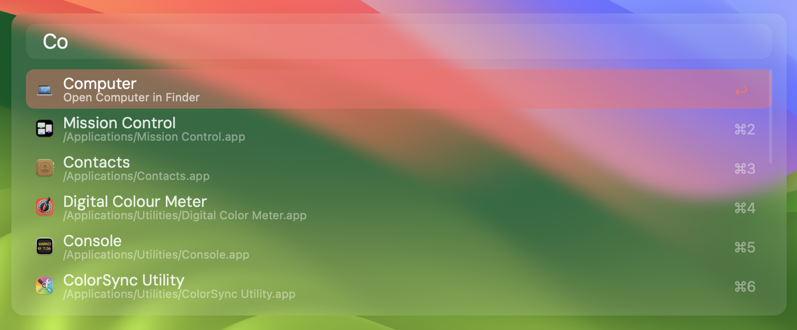 | 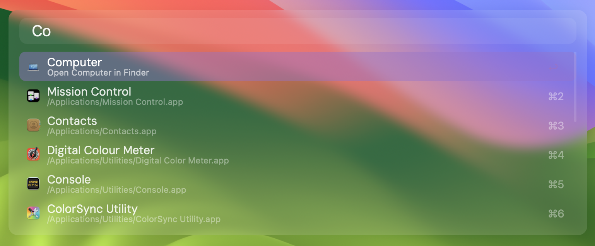 |
| **Dark** | 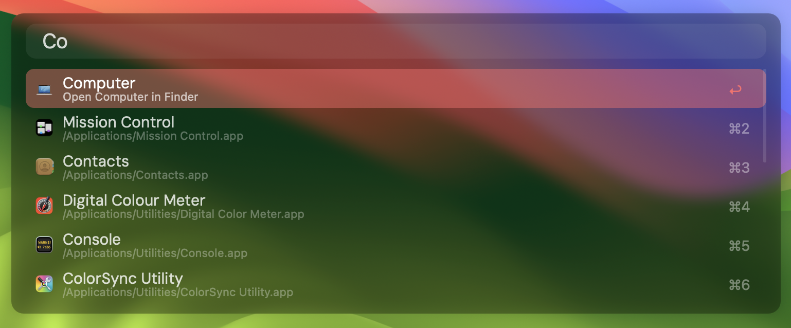 | 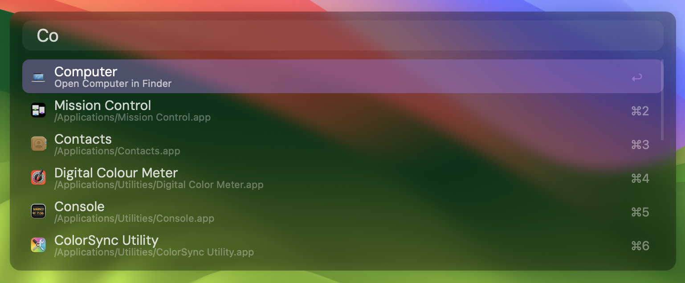 |

### Hazy (native vibrancy)

Light and Dark, in Coral and Violet. No screenshots yet.

---

## New themes

Six more designs, each in light and dark. **The previews below are rendered mockups, not Alfred screenshots**: an HTML approximation of Alfred over sample wallpapers (light theme on a light wallpaper, dark on a dark one). Real Alfred rendering differs slightly.

### Clear Violet II

Clear Violet, refined: lighter tint so more blur shows through, a crisper hairline border, a quieter accent selection, and tighter subtext.

| Light | Dark |
|---|---|
| 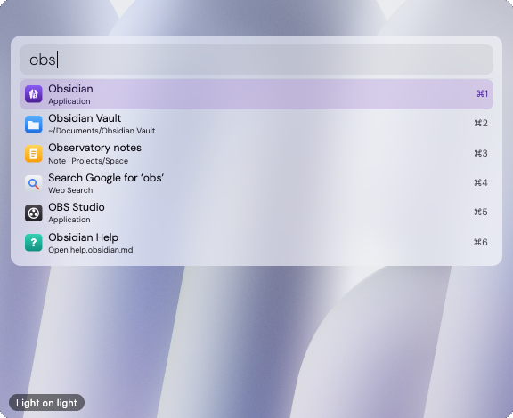 | 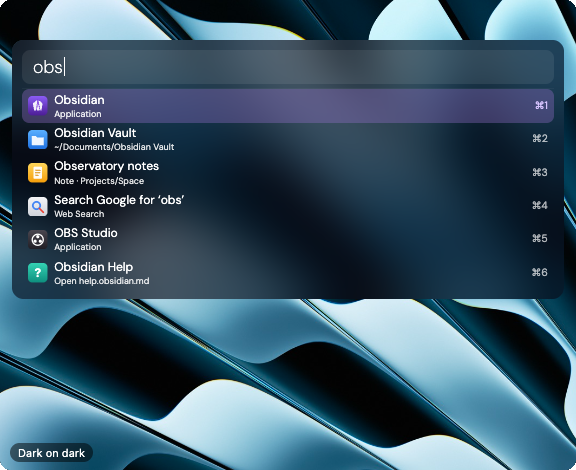 |

### Deep Frost

Heavy frosted glass: max blur, a milky white (light) or smoked black (dark) slab, big airy layout with 38pt light search, 40px icons and generous row padding.

| Light | Dark |
|---|---|
| 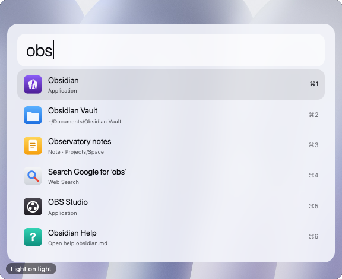 | 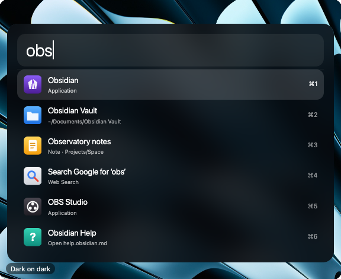 |

### Native

Real macOS vibrancy in SF Pro with a neutral grey selection and no accent except a system-blue shortcut color: calm and Spotlight-native.

| Light | Dark |
|---|---|
| 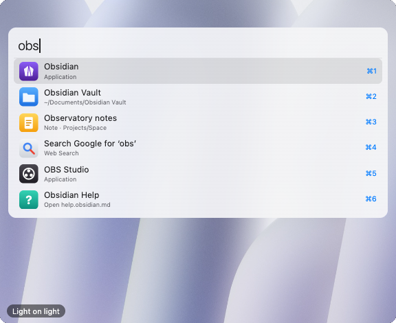 | 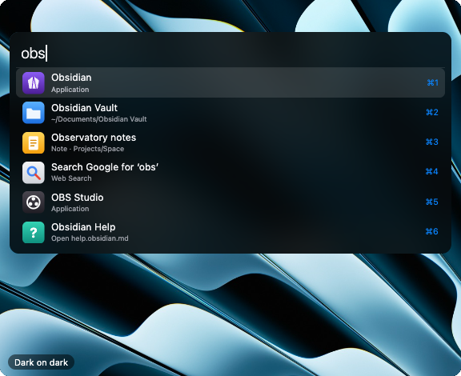 |

### Ink Hairline

Compact 560px sharp panel with a visible ink frame, 19px icons, 4-6px corners, hard separators and a dense near-opaque tint, with coral appearing only as a thin saturated selection bar.

| Light | Dark |
|---|---|
| 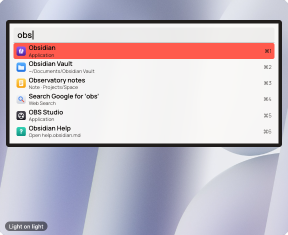 | 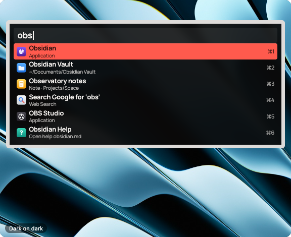 |

### Tinted Glass

Colored glass. The window tint IS the accent (violet in light, deep teal-to-violet in dark) at low alpha over blur 30, so the wallpaper shows through colored. Selection is translucent white. Manrope.

| Light | Dark |
|---|---|
| 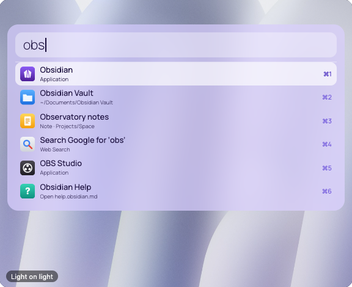 | 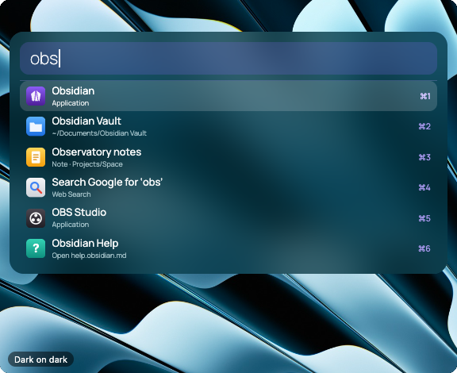 |

### Editorial

Type-led. Huge search text (44-46, a thin weight), results at 22-24, minimal chrome, no search-field fill, wide (720), a quiet blur. DM Sans. Feels like a magazine headline.

| Light | Dark |
|---|---|
| 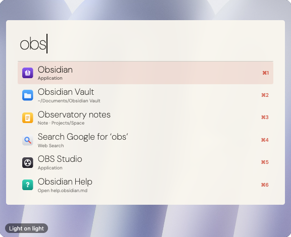 | 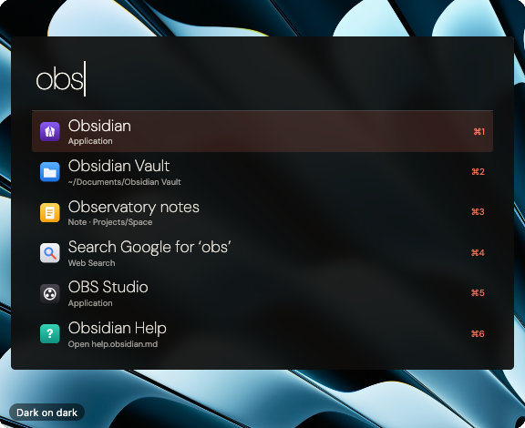 |

---

## Install

1. Download the `.alfredappearance` file
2. Double-click it
3. Pick it in **Preferences > Appearance**

---

## Colors (Clear and Hazy)

| Token | Value |
|-------|-------|
| Coral | `#FF6B6B` |
| Violet | `#9B72CF` |
| Selection | Accent color at 45% opacity |
| Clear light window | `#FFFFFF` at 12% opacity, 30px blur |
| Clear dark window | `#000000` at 33% opacity, 30px blur |
| Hazy light window | `#FFFFFF` at 8% opacity, macOS vibrancy |
| Hazy dark window | `#000000` at 19% opacity, macOS vibrancy |

---

## Fonts

Clear and Hazy use **DM Sans** and **Inter**. Both free from Google Fonts:

- [DM Sans](https://fonts.google.com/specimen/DM+Sans)
- [Inter](https://fonts.google.com/specimen/Inter)

The six newer themes use:

| Font | Used by | Where to get it |
|------|---------|-----------------|
| DM Sans | Clear Violet II, Editorial | [Google Fonts](https://fonts.google.com/specimen/DM+Sans) |
| Manrope | Ink Hairline, Tinted Glass | [Google Fonts](https://fonts.google.com/specimen/Manrope) |
| SF Pro (Text and Display) | Deep Frost, Native | [Apple](https://developer.apple.com/fonts/) |

The themes ask for specific weights (ExtraLight, Light, Medium, SemiBold), so install the whole family, not one weight.

System font works as a fallback.

---

## License

MIT
